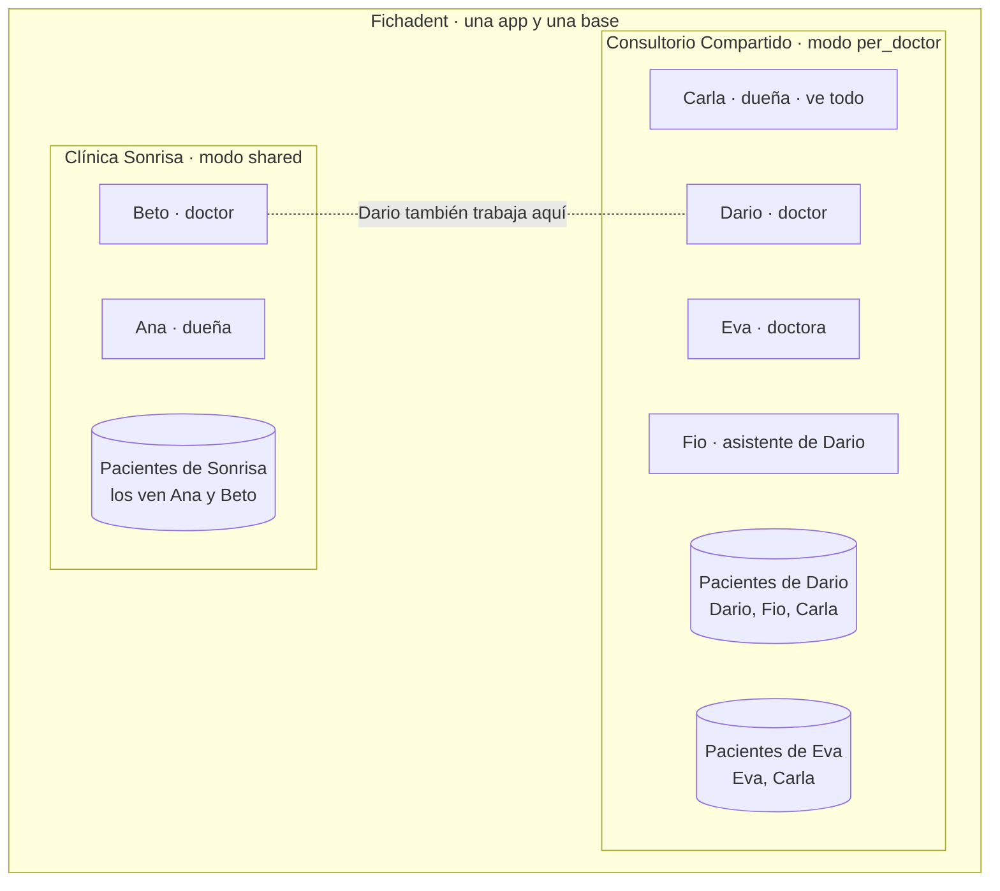

> **Futuro, no es parte del MVP.** El MVP es 1 doctor = 1 consultorio (ver `00-fichadent-mvp.md`). Este documento describe cómo crecer a varios doctores; su migración se rehará sobre `0001_fichadent.sql` cuando toque.

# Spec 04 · Fichadent: varias clínicas y varios doctores

| | |
|---|---|
| **Producto** | Fichadent (fork de Goldent) |
| **Migración** | `supabase/migrations/0003_multiclinic_multidoctor.sql` (sobre 0001 + 0002) |
| **Estado** | Migración probada en local con rol sin superusuario: 10 escenarios OK |
| **Relacionado** | [Definición del producto](https://claude.ai/artifact/ARnoQFZE8roi8YBrckV68a) · Spec 01 (modelo de datos) |

## 1. La regla en una frase

Nadie ve datos de otra clínica, y dentro de una clínica la dueña elige si los doctores **comparten** pacientes o si **cada doctor ve solo los suyos**. Todo se aplica en la base de datos (RLS), no en la pantalla: aunque alguien manipule la app, Postgres no le devuelve filas ajenas.

## 2. Dos niveles de aislamiento



| Nivel | Qué separa | Cómo |
|---|---|---|
| **1. Clínica** | Una clínica no ve nada de otra | `clinic_id` en todas las tablas + RLS con `current_clinic_id()` |
| **2. Doctor** | En modo `per_doctor`, un doctor no ve los pacientes de otro | `patients.doctor_id` (tratante) + `patient_shares` + RLS con `patient_visible()` |

**¿Cuándo usar cada modo?**

| Caso real | Configuración |
|---|---|
| Consultorio de una doctora (Goldent) | 1 clínica, `shared` |
| Clínica con doctores empleados que se pasan pacientes | 1 clínica, `shared` |
| Local donde varios doctores independientes alquilan sillón | 1 clínica, `per_doctor` (comparten agenda/recepción, no historias) |
| Doctor que atiende en dos clínicas distintas | 2 membresías; elige la clínica activa en la app |

## 3. Modelo de datos (lo nuevo)

| Tabla / columna | Para qué |
|---|---|
| `clinics.patient_visibility` | `shared` (todos ven todo) o `per_doctor` |
| `clinics.slug`, `brand_color`, `plan`, `trial_ends_at` | Subdominio de su web, marca, plan y fin de prueba |
| `memberships (user_id, clinic_id, role, display_name, sees_all_patients, active)` | Reemplaza a `staff`. Un usuario puede estar en varias clínicas |
| `profiles.active_clinic_id` | Clínica activa del usuario. Se cambia con `rpc('set_active_clinic')` |
| `assistant_doctors` | A qué doctores asiste cada asistente (solo cuenta en `per_doctor`) |
| `patients.doctor_id` | Doctor tratante. Se llena solo cuando lo crea un doctor |
| `patient_shares (patient_id, doctor_id)` | Compartir un paciente con otro doctor de la clínica (interconsulta) |
| `visits.doctor_id`, `appointments.doctor_id` | Quién atendió y para quién es la cita (agenda por doctor) |

**Funciones clave**

| Función | Devuelve |
|---|---|
| `current_clinic_id()` | La clínica activa (la elegida, si sigue siendo miembro; si no, la primera) |
| `patient_visible(clinic, doctor, patient)` | ¿Puedo ver esta fila de paciente? Recibe las columnas para que funcione en el `INSERT … RETURNING` |
| `can_see_patient(patient_id)` | Lo mismo para tablas hijas (visitas, tratamientos, archivos, antecedentes, citas, consentimientos) |
| `can_see_patient_path(name)` | Lo mismo para Storage (`{clinic_id}/{patient_id}/archivo`) |
| `set_active_clinic(clinic)` | Cambia la clínica activa; error si no eres miembro |

## 4. Quién ve qué

| Rol | Modo `shared` | Modo `per_doctor` |
|---|---|---|
| **Dueña** (`owner`) | Todo | Todo si `sees_all_patients = true` (por defecto en la dueña). Gestiona usuarios |
| **Doctor** (`dentist`) | Todo | Sus pacientes (`doctor_id`) + los que le compartieron |
| **Asistente** (`assistant`) | Todo | Pacientes de los doctores a los que asiste |
| **Auditoría** | Solo quien tiene `sees_all_patients` | Igual |

Lo que hereda la visibilidad del paciente: antecedentes, visitas, tratamientos, archivos (tabla y Storage), citas y consentimientos. El buscador (`search_patients`) y Recientes (`recent_patients`) se filtran solos porque son `security invoker`.

## 5. Reglas de negocio

1. **Crear paciente:** si lo crea un doctor, queda como tratante. En `per_doctor`, una asistente debe elegir el doctor; si no, error "Elige el doctor tratante del paciente".
2. **Asignar a otro:** un doctor no puede crear ni mover un paciente a otro doctor (la fila dejaría de ser suya y RLS lo rechaza). Solo quien ve todo puede reasignar.
3. **Compartir:** quien ve al paciente puede compartirlo con otro doctor de la clínica. Lo puede quitar quien lo compartió o la dueña. Queda en auditoría.
4. **DNI repetido en `per_doctor`:** el DNI sigue siendo único por clínica. Si Eva registra un DNI que ya es paciente de Dario, el `insert` falla (23505) y la app debe decir: "Este DNI ya está registrado en la clínica. Pide a la dueña o al doctor tratante que te lo comparta." Revela que la persona es paciente de la clínica, no sus datos.
5. **Usuarios:** solo la dueña invita, cambia roles o desactiva. Un doctor no puede darse `sees_all_patients` a sí mismo.
6. **Varias clínicas:** cambiar de clínica es un `rpc` validado; no se puede activar una clínica de la que no eres miembro.

## 6. Pruebas hechas (Postgres 16 local, rol sin superusuario)

| # | Escenario | Resultado |
|---|---|---|
| 1 | Clínica `shared`: Ana crea, Beto ve | OK |
| 2 | `per_doctor`: Dario y Eva solo ven lo suyo (tabla, buscador, recientes, visitas) | OK |
| 3 | Asistente de Dario ve solo a los de Dario; la dueña ve todo y la auditoría | OK |
| 4 | Eva no puede crear visitas, editar ni asignarse pacientes de Dario, ni leer auditoría | Bloqueado |
| 5 | Asistente sin doctor en `per_doctor` | Error claro |
| 6 | Dario comparte a Pedro con Eva → Eva ve paciente, visita y archivo | OK |
| 7 | Storage: subir a paciente ajeno o a ruta inválida | Bloqueado |
| 8 | Dario cambia a Sonrisa: ve Sonrisa; no puede escribir en Compartido | OK |
| 9 | Beto intenta activar una clínica ajena | Bloqueado |
| 10 | Eva intenta darse "ver todo" o invitar usuarios | Bloqueado |

Además: los datos existentes (una clínica con `staff` y pacientes) migran solos; la dueña queda con `sees_all_patients` y sus pacientes con ella como tratante.

## 7. Cambios en la app

| Archivo / área | Cambio |
|---|---|
| `lib/data/session.ts`, `lib/actions/auth.ts` | Leer `memberships` de la clínica activa en vez de `staff`. Devolver rol, `display_name`, clínica (nombre, color, logo, modo) |
| `UserMenu` | Selector de clínica si el usuario tiene más de una → `rpc('set_active_clinic')` + `router.refresh()` |
| Marca | `Logo`, `SideNav`, `BrandPanel`, `metadata`: nombre "Fichadent" en el producto y **nombre/logo/color de la clínica** dentro de la app |
| `PatientForm`, `QuickCaptureForm` | En `per_doctor` y rol asistente: selector "Doctor tratante" (miembros `dentist`/`owner`) |
| Ficha | Acción "Compartir con otro doctor" (solo en `per_doctor`) + mostrar tratante y con quién está compartido |
| `lib/actions/errors.ts` | 23505 en `per_doctor` → mensaje de la regla 4 |
| Visitas y citas | Enviar `doctor_id` (por defecto el usuario); agenda filtrable por doctor |
| `types/database.ts` | Regenerar con `supabase gen types` |
| Panel de alta (siguiente) | Reemplazar el SQL manual de la sección 8 de la migración |

## 8. Plan del fork Goldent → Fichadent

**Decisión:** fork en repo nuevo y **proyecto de Supabase nuevo**. Goldent sigue intacto en producción. Cuando Fichadent esté estable, Goldent se migra como una clínica más y se deja de mantener el repo viejo (dos códigos para siempre es el doble de trabajo).

1. **Repo:** crear `kevocam/fichadent` copiando `goldent-web` con historial:
   ```bash
   git clone https://github.com/kevocam/goldent-web fichadent && cd fichadent
   git remote set-url origin https://github.com/kevocam/fichadent.git && git push -u origin main
   ```
2. **Supabase:** proyecto nuevo `fichadent`, región São Paulo, plan Pro antes del primer cliente. Correr 0001, 0002 y 0003. No copiar datos de Goldent.
3. **Renombrar:** `grep -rniE "goldent" src docs` y reemplazar marca del producto; cookies `gd_session`/`gd_remember` → `fd_session`/`fd_remember`; `package.json` name; textos de login y metadata.
4. **Marca por clínica:** los colores dorado/rosa pasan a ser el tema de Goldent; Fichadent define su tema base y cada clínica su `brand_color`.
5. **Código multi-doctor:** sección 7.
6. **Datos de demo:** script de seed con una clínica ficticia por modo (`shared` y `per_doctor`), pacientes de ejemplo y usuarios de prueba.
7. **Deploy:** proyecto nuevo en Vercel (Pro, uso comercial) con las variables del Supabase nuevo; dominio cuando se confirme la marca.
8. **Verificar:** repetir los 10 escenarios de la sección 6 contra el Supabase nuevo con dos navegadores (dos doctores) antes de invitar clínicas.

## 9. Pendientes

- [ ] Confirmar el nombre Fichadent (INDECOPI y dominio) antes del paso 7 del fork
- [ ] Modo por defecto al crear una clínica: propuesta `shared`
- [ ] ¿La dueña en `per_doctor` ve historias clínicas de los doctores independientes, o solo agenda? Hoy: ve todo si `sees_all_patients`; para alquiler de sillón conviene `false`
